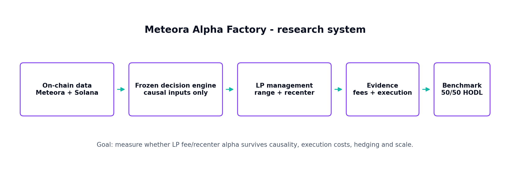
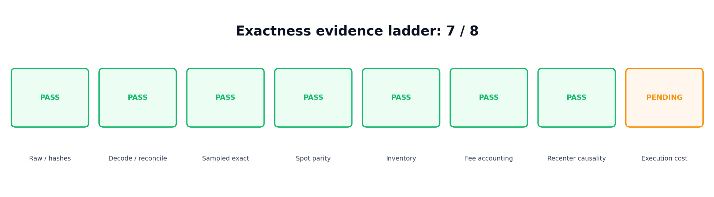
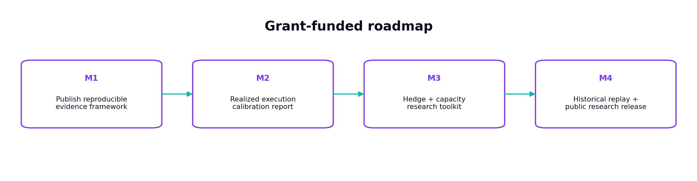

# Meteora Alpha Factory

**Independent research tooling for causal evaluation of actively managed Meteora DLMM liquidity on Solana.**

[Executive one-pager](docs/METEORA_ALPHA_FACTORY_EXECUTIVE_ONE_PAGER.pdf) | [Research status](docs/RESEARCH_STATUS.md) | [Methodology](docs/METHODOLOGY.md) | [Roadmap](docs/ROADMAP.md)

> Research project. No live-capital claim, no guaranteed return, and no claim that historical proxy results equal exact LP execution.

## Why this exists

Concentrated-liquidity strategies can look attractive in simple backtests while hiding future-data leakage, incomplete fee accounting, unrealistic recenter execution, directional inventory exposure and capacity limits.

Meteora Alpha Factory is designed to make those failure modes visible.



## Current status

- Internal evidence ladder: **7 / 8**.
- Frozen control and challenger research policies.
- Fee-accounting and causal-finality validation completed under the current protocol.
- The original +300 second live-data witness was rejected after observed revisions.
- A multi-witness study identified +600 seconds as the earliest tested candidate meeting the frozen stability rule.
- Independent fresh-forward +600 second validation passed:
  - **12 / 12** real-time decision parity;
  - **12 / 12** exact OHLC stability after the witness;
  - **12 / 12** volume equality in the validation run;
  - **0** future-input violations.
- Realized execution-cost calibration remains the open exactness gate.
- Live strategy capital is disabled.

These results are evidence about the research pipeline, not a forecast of investment returns.

## Research principles

1. Freeze strategy rules before evaluating new outcome data.
2. Use only information causally available at decision time.
3. Benchmark LP NAV against a fixed 50/50 SOL-USDC portfolio.
4. Separate modeled execution costs from realized execution evidence.
5. Include hedge funding, trading fees and slippage as first-class costs.
6. Distinguish exact, reconstructed, proxy and descriptive evidence.
7. Prefer a failed test over a retroactively "fixed" backtest.

## Public scope

This repository is the sanitized public surface for:

- causal evidence schemas and validation methodology;
- LP accounting and benchmark methodology;
- modeled-vs-realized execution calibration research;
- dynamic hedge accounting;
- capacity-ladder analysis;
- historical replay methodology and exactness labeling.

Strategy-specific alpha thresholds, private pool-selection logic, custody procedures, API secrets and private keys are intentionally excluded.

## Public tooling v0.1

The repository now includes a minimal reproducibility layer that can be run without strategy secrets or live infrastructure:

```bash
python -m pip install -r requirements-dev.txt
python tools/verify_evidence.py --repo-root . --strict
python -m unittest discover -s tests -v
```

The validator checks the public JSON Schema, cross-field causal-evidence invariants and SHA-256 integrity for the sanitized evidence files. GitHub Actions runs the same checks on pushes and pull requests. See [Public tooling](docs/PUBLIC_TOOLING.md).

No proprietary alpha threshold, pool-selection logic, custody material, signing logic or private key is included.

## Evidence snapshots

- [Multi-witness finality study](evidence/H1C9_MULTI_WITNESS_SUMMARY.json)
- [Independent +600 second fresh-forward validation](evidence/H1C11_TPLUS600_VALIDATION_SUMMARY.json)
- [Evidence notes and limitations](evidence/README.md)
- [SHA-256 manifest](evidence/SHA256SUMS.txt)



## Roadmap

1. Realized execution-cost calibration.
2. Dynamic SOL hedge research.
3. Capacity ladder using real pool and hedge-market states.
4. Post-freeze historical replay across available Meteora and hedge-market history.
5. Public research report and reusable tooling release.



## Project lead / contact

**Lucas Carvalho Passos**  
Email: `lucascpas23@gmail.com`  
GitHub: [@lucascpas23](https://github.com/lucascpas23)

Use GitHub Issues for public technical questions after the repository is published. Use email for grant, sponsorship or diligence conversations.

## Independence and risk notice

Meteora Alpha Factory is an independent project and is not affiliated with Meteora, Solana Foundation or Superteam. Nothing in this repository is an offer of securities, investment advice, a promise of yield or a guarantee that experimental capital will be preserved.
