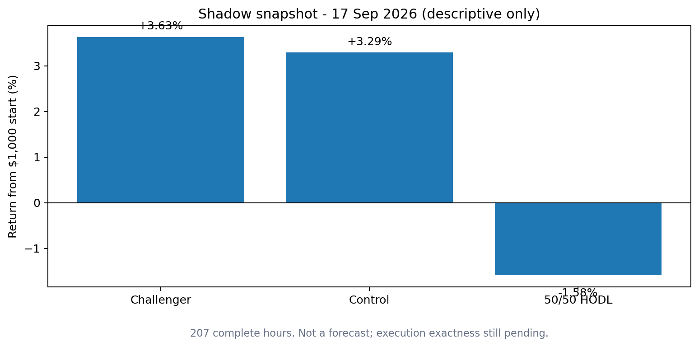

# Research status

## Evidence state

| Layer | Status | Interpretation |
|---|---:|---|
| Frozen research policies | PASS | Control and challenger frozen; no post-outcome retuning. |
| Fee accounting | PASS | Current accounting gate passed under frozen measurement rules. |
| Live causal alignment | PASS | +300s rejected; +600s selected through a multi-witness study. |
| Independent fresh-forward finality | PASS | 12/12 decision parity, 12/12 OHLC stability, zero future-input violations. |
| Realized execution cost | PENDING | Final exactness gate; requires the frozen multi-cycle realized study. |
| Dynamic SOL hedge | NEXT | Includes funding, fees, slippage and dynamic delta behavior. |
| Capacity ladder | NEXT | Computational scaling analysis on real states. |
| Historical replay | NEXT | Post-freeze replay with explicit exact/reconstructed/proxy labels. |

## Current claim boundary

The project may claim that the +600 second witness passed the current causal-finality validation protocol. It may not yet claim:

- exact realized execution economics;
- durable CAGR;
- exact historical LP alpha;
- live readiness;
- guaranteed profitability.

## Descriptive shadow snapshot

A short shadow window produced economically interesting results, but it is deliberately labeled descriptive and not a forecast. It is included to motivate the remaining research, not to support an annualized return claim.

